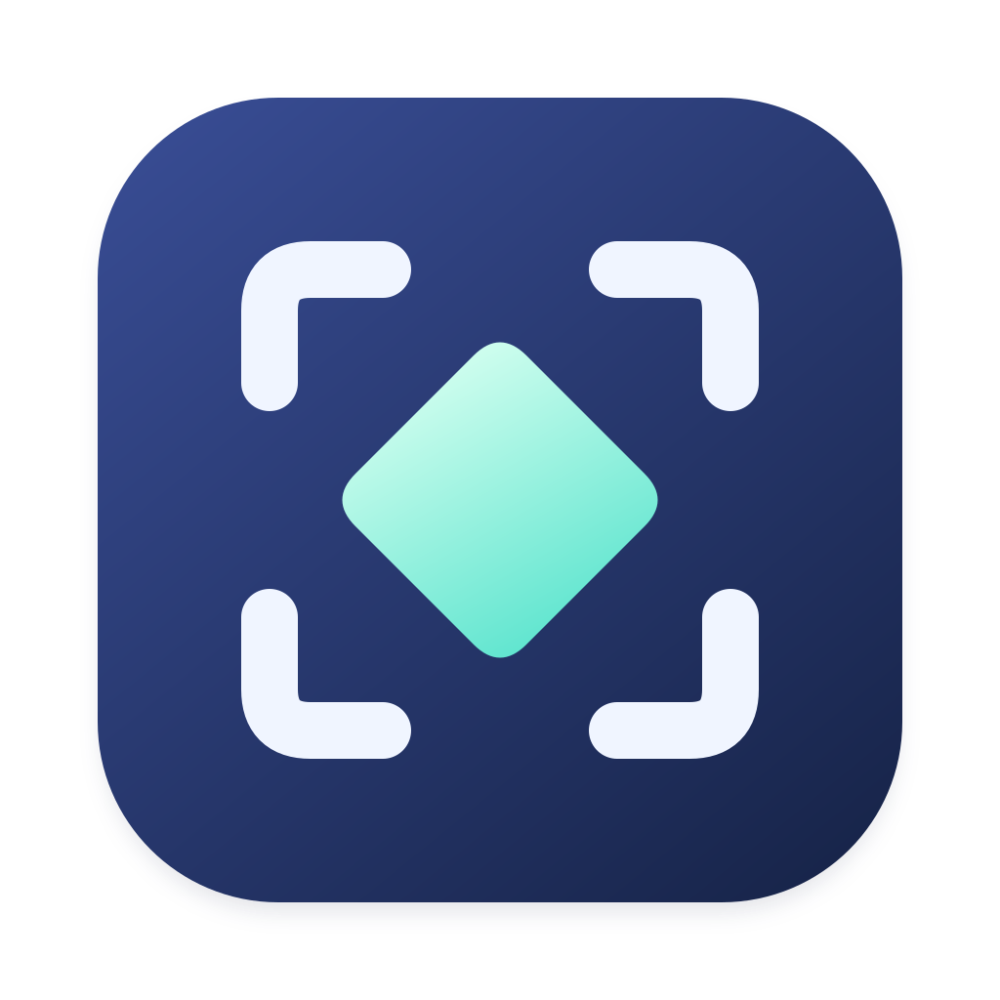

<p align="center">
  
</p>

<h1 align="center">Anyview</h1>

<p align="center">
  <strong>A fast, quiet, native cross-platform image viewer powered by a shared Rust core.</strong><br>
  macOS (AppKit / Liquid Glass) · Windows (WinUI 3 / Native AOT) · Linux (GTK 4)
</p>

<p align="center">
  <a href="https://github.com/MUMU-DADA/anyview/actions/workflows/ci.yml"></a>
  <a href="https://github.com/MUMU-DADA/anyview/releases/latest"></a>
  <a href="LICENSE"></a>
  
  
</p>

<p align="center">
  <strong>English</strong> · <a href="README.zh-CN.md">简体中文</a>
</p>

---

## Overview

**Anyview** is a lightweight desktop image viewer designed around speed, visual clarity, and native OS ergonomics.

- **Shared Rust core, native UI everywhere** — Decoding, color management, archive browsing, caching, keyboard/mouse mapping, and settings live in a single Rust core (`anyview-core`). Each platform builds a real native shell on top of it: **Swift + AppKit** on macOS, **C# + WinUI 3 (Native AOT)** on Windows, and **Rust + GTK 4** on Linux.
- **Image-first frameless window** — By default, the window sizes itself to the image with no persistent chrome. Title bar, navigation arrows, and control bar appear only when needed.
- **Strictly read-only by design** — Viewing adjustments (zoom, rotation, flip, invert, gamma, sharpening) never alter files on disk. File operations (copy, move, trash, external editor) run only when explicitly triggered.

---

## Features

### Formats & Archives
- **Standard & Web:** JPEG, PNG / APNG, GIF, WebP, BMP, TIFF (multi-page), TGA, PNM (`PBM`/`PGM`/`PPM`/`PAM`), QOI, ICO / CUR
- **Modern & HDR:** AVIF (static & animated, with HDR/wide-gamut tone mapping), HEIC / HEIF / HEICS, JPEG XL (static & animated), JPEG 2000, JPEG XR, OpenEXR, Radiance HDR (`.hdr`)
- **Design & Vector:** PSD / PSB (embedded composite + fallback layer compositing with opacity and pixel/vector masks), Clip Studio Paint (`.clip`), DDS (BC1–BC7 & legacy formats), PCX, SVG / SVGZ (vector re-rendering on zoom, external resource loading blocked)
- **Camera RAW:** Fast embedded JPEG preview extraction plus full RAW decoding via LibRaw (and ImageIO on macOS) across DNG, CR2/CR3, NEF, ARW, RAF, ORF, RW2, PEF, 3FR, IIQ, and more
- **Direct Archive Browsing:** Browse images inside **ZIP / CBZ**, **7Z / CB7**, and **RAR / CBR** archives like folders without unpacking, with per-archive resume position memory

### Viewing, Reading & Color
- **Fast launch & smart prefetch:** Concurrent startup decoding, EXIF thumbnail fast preview for large JPEGs, generation-cancelled background jobs, and directional prefetch (configurable 1–20 images, 100–4096 MB cache).
- **Dual-path rendering:** Smooth GPU-transformed pan/zoom during interaction, plus background SIMD high-quality resampling (`Bicubic` / `Lanczos` + optional sharpening) when settled.
- **Comics & photo workflows:** Fit-to-window / original size / fit-to-width, smart two-page spread (LTR & RTL), page-turn transitions with optional synthesized page-turn sound, thumbnail picker window, natural sorting, and seamless next/previous folder or archive traversal.
- **Color management & metadata:** Embedded ICC profiles (ColorSync on macOS, `qcms` on Windows/Linux), optional monitor ICC profile support, EXIF overlay, and an AI generation metadata inspector (Stable Diffusion WebUI, ComfyUI, NovelAI, etc.).
- **Animations:** Playback, pause, and frame-by-frame stepping for GIF, APNG, WebP, JXL, AVIF, and HEIF sequences.

### Native Integration & Customization
- **macOS (14+, Apple Silicon):** AppKit + Core Animation canvas, full trackpad gestures, Liquid Glass control bar with selectable hover effects on macOS 26+, and bundled Quick Look Thumbnail & Preview extensions.
- **Windows (10 1809+ / 11 x64):** WinUI 3 + Win2D compiled via Native AOT, optional menu bar, per-user Explorer thumbnail provider (`IThumbnailProvider`) and optional context menu, NSIS installer and portable ZIP mode.
- **Linux (GTK 4.14+, Wayland & X11):** Native GTK 4 UI (no libadwaita lock-in), single-instance Unix socket handoff, MIME default-viewer integration, file manager thumbnailer support, and offline-built Flatpak bundle.
- **Full input remapping & 19 languages:** Remap keyboard shortcuts and mouse buttons; localized in 19 languages (English, 简体中文, 繁體中文, 日本語, 한국어, Español, Français, Deutsch, Português (Brasil), Русский, Italiano, Türkçe, Polski, Nederlands, Tiếng Việt, Bahasa Indonesia, ไทย, Українська, हिन्दी).

---

## Architecture

```text
apps/macos (Swift + AppKit)  ──┐
apps/windows (C# + WinUI 3)  ──┼── UniFFI + Zero-copy C buffer API ──▶ crates/anyview-ffi
                                                                              │
apps/linux (Rust + GTK 4)    ─────────────────────────────────────────────────┼──▶ crates/anyview-core
                                                                                      ├── crates/anyview-libraw
                                                                                      └── crates/anyview-jxr
```

| Directory | Description |
| --- | --- |
| `crates/anyview-core` | Platform-independent Rust core (decoders, session, view math, cache, render, settings, i18n) |
| `crates/anyview-ffi` | UniFFI exports and zero-copy BGRA buffer C API for Swift & C# |
| `crates/anyview-libraw` | LibRaw C++ wrapper crate for full camera RAW decoding |
| `crates/anyview-jxr` | jxrlib C wrapper crate for JPEG XR decoding |
| `crates/anyview-fixtures` | Synthetic test-image generator and decoder verification tool |
| `apps/macos` | macOS AppKit app and Quick Look Thumbnail / Preview extensions |
| `apps/windows` | Windows WinUI 3 Native AOT app and C# binding integration tests |
| `apps/linux` | Linux GTK 4 app and Flatpak manifest |
| `tools/` | Build, packaging, self-test, icon, i18n, license, and test-corpus scripts |
| `third_party/` | Vendored third-party libraries (see [THIRD_PARTY_NOTICES.md](THIRD_PARTY_NOTICES.md)) |

---

## Building from Source

The Rust toolchain version is pinned in [`rust-toolchain.toml`](rust-toolchain.toml).

### Core Unit Tests

```bash
cargo test --locked
```

### macOS

Requires macOS 14+ (Apple Silicon), Xcode Command Line Tools, and Rust:

```bash
# Build Rust core, generate Swift bindings, compile Anyview.app & extensions, and run tests
# Pass ANYVIEW_BUILD_ONLY=1 to skip the interactive GUI self-test window pass
bash tools/macos/编译测试.command

# Package Anyview.app into out/macos/Anyview-<version>.dmg
bash tools/macos/打包.command
```

See [`apps/macos/README.md`](apps/macos/README.md) for details.

### Windows

Requires MinGW-w64 (for cross-compiling the Rust core and C# bindings) plus .NET 10 SDK and Visual Studio C++ build tools on Windows:

```bash
# 1. Cross-compile core DLL and generate C# bindings (on Linux/MinGW-w64)
bash tools/windows/build-core.sh

# 2. Build Native AOT app and run self-tests (on Windows)
tools\windows\编译测试.cmd

# 3. Stage & package installer (NSIS) or portable ZIP
powershell -File tools\windows\package.ps1 -Action stage
bash tools/windows/build-installer.sh
bash tools/windows/build-portable.sh
```

### Linux

Requires GTK 4.14+ development libraries:

```bash
cargo build --release --locked -p anyview-linux

# Optional: run headless Wayland self-tests or build offline Flatpak bundle
bash apps/linux/scripts/selftest.sh
bash tools/linux/flatpak/build.sh
```

---

## Documentation

Detailed technical documents live in [`docs/`](docs/):

- [Architecture](docs/ARCHITECTURE.md)
- [Supported Formats](docs/FORMATS.md)
- [Platform Notes](docs/PLATFORMS.md)
- [Actions & Shortcuts](docs/ACTIONS.md)
- [Menus & Overlays](docs/MENUS.md)
- [Settings Reference](docs/SETTINGS.md)

---

## License & Third-Party Notices

Anyview is released under the [MIT License](LICENSE).

Bundled third-party components retain their original licenses, including **LibRaw** (CDDL-1.0), **jxrlib** (BSD-2-Clause), official **UnRAR** source (freeware, extraction only), **uniffi-bindgen-cs** (MPL-2.0), optional Windows `heif.dll` (**libheif** + **libde265**, LGPL-3.0-or-later), and Rust dependencies (predominantly MIT / Apache-2.0). See [THIRD_PARTY_NOTICES.md](THIRD_PARTY_NOTICES.md) for full details.

Inside the app, **Help › Open Source Licenses** (and **About** on Windows and Linux) displays the full license texts; release bundles also ship `LICENSE.txt` and `THIRD-PARTY-NOTICES.txt` generated by `tools/licenses/generate.sh`.
