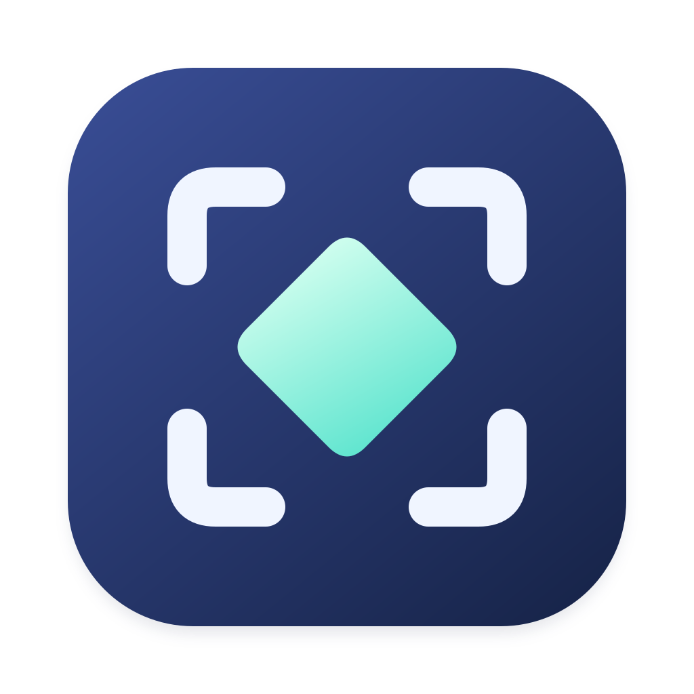

<p align="center">
  
</p>

<h1 align="center">Anyview</h1>

<p align="center">
  <strong>快速、安静、全平台原生体验的跨平台看图软件，由共用 Rust 核心驱动。</strong><br>
  macOS（AppKit / Liquid Glass）· Windows（WinUI 3 / Native AOT）· Linux（GTK 4）
</p>

<p align="center">
  <a href="https://github.com/MUMU-DADA/anyview/actions/workflows/ci.yml"></a>
  <a href="https://github.com/MUMU-DADA/anyview/releases/latest"></a>
  <a href="LICENSE"></a>
  
  
</p>

<p align="center">
  <a href="README.md">English</a> · <strong>简体中文</strong>
</p>

---

## 简介

**Anyview** 是一款专注启动速度、浏览流畅度与各平台原生手感的桌面看图软件。

- **一套 Rust 共用核心，三端纯原生界面** — 图片解码、色彩管理、压缩包浏览、后台缓存、键鼠映射与设置系统全部收敛在 Rust 核心（`anyview-core`）；界面层分别采用各系统原生技术栈：**macOS（Swift + AppKit）**、**Windows（C# + WinUI 3 Native AOT）**、**Linux（Rust + GTK 4）**。
- **窗口即图片** — 默认采用按图自适应的无边框窗口，标题栏、边缘翻页箭头与控制栏按需浮现，不干扰看图。
- **只看不改** — 缩放、旋转、翻转、反相、Gamma、锐化等均为实时视图效果，绝不修改原图文件；复制、移动、删除、外部编辑器打开等操作仅在用户明确触发时执行。

---

## 功能特性

### 格式与压缩包
- **常见与网页格式**：JPEG、PNG / APNG、GIF、WebP、BMP、TIFF（多页）、TGA、PNM（`PBM`/`PGM`/`PPM`/`PAM`）、QOI、ICO / CUR
- **现代与 HDR 格式**：AVIF（静态与动图，支持 HDR / 广色域色调映射）、HEIC / HEIF / HEICS、JPEG XL（静态与动图）、JPEG 2000、JPEG XR、OpenEXR、Radiance HDR（`.hdr`）
- **设计与矢量格式**：PSD / PSB（兼容合成图与自主图层合成，支持不透明度、像素蒙版与矢量蒙版）、Clip Studio Paint（`.clip`）、DDS（BC1–BC7 及旧式格式）、PCX、SVG / SVGZ（缩放时按屏幕像素实时矢量重绘，禁止加载外部资源）
- **相机 RAW**：高速提取内嵌 JPEG 预览，并内置 LibRaw 完整显影（macOS 优先 ImageIO），覆盖 DNG、CR2/CR3、NEF、ARW、RAF、ORF、RW2、PEF、3FR、IIQ 等主流机型
- **压缩包直看**：无需解压即可像普通文件夹一样浏览 **ZIP / CBZ**、**7Z / CB7**、**RAR / CBR** 内的图片，自动记忆每个压缩包上次看到的位置

### 浏览、阅读与色彩
- **快速启动与方向预读**：启动并发解码、大尺寸 JPEG 先出 EXIF 内嵌缩略图快速预览、带代次号取消的后台线程池、按翻页方向智能预读（默认 5 张 / 1 GB 缓存，可在设置中自由调整）。
- **双路径渲染**：缩放与平移过程由 GPU 变换矩阵直接驱动；静止后后台以 SIMD 高质量重采样（`Bicubic` / `Lanczos` + 可选锐化）覆盖可见区域。
- **漫画与照片浏览**：适合窗口 / 原始大小 / 适合宽度、智能双页阅览（支持从左到右与从右到左）、翻页过渡效果与内置合成翻纸音效、缩略图选图窗口、自然排序与跨文件夹/压缩包连续翻页。
- **色彩管理与元数据**：支持图片内嵌 ICC（macOS 由 ColorSync 接管，Windows/Linux 使用 `qcms`）与显示器 ICC；支持左上角 EXIF 信息浮层与 AI 生图参数查看（Stable Diffusion WebUI、ComfyUI、NovelAI 等）。
- **动图控制**：支持 GIF、APNG、WebP、JXL、AVIF、HEIF 序列的播放、暂停与逐帧查看。

### 原生系统集成与自定义
- **macOS（14+，Apple Silicon）**：AppKit + Core Animation 画布、完整触控板手势、macOS 26+ 原生 Liquid Glass 控制栏（含三种可选悬停效果），内置 Quick Look 缩略图与空格预览扩展。
- **Windows（10 1809+ / 11 x64）**：WinUI 3 + Win2D 并以 Native AOT 编译，支持可选顶部菜单栏、当前用户级资源管理器缩略图提供程序（`IThumbnailProvider`）与可选右键菜单，提供 NSIS 安装包与免安装便携 ZIP。
- **Linux（GTK 4.14+，Wayland / X11）**：纯 GTK 4 界面（无 libadwaita 绑定）、Unix 套接字单实例转交、MIME 默认看图关联、文件管理器缩略图器支持与离线构建 Flatpak 包。
- **完整键鼠映射与 19 种语言**：支持自定义键盘快捷键与鼠标按键映射；内置 19 种界面语言（English、简体中文、繁體中文、日本語、한국어、Español、Français、Deutsch、Português (Brasil)、Русский、Italiano、Türkçe、Polski、Nederlands、Tiếng Việt、Bahasa Indonesia、ไทย、Українська、हिन्दी）。

---

## 项目结构

```text
apps/macos (Swift + AppKit)  ──┐
apps/windows (C# + WinUI 3)  ──┼── UniFFI + 零复制 C 缓冲区接口 ──▶ crates/anyview-ffi
                                                                          │
apps/linux (Rust + GTK 4)    ─────────────────────────────────────────────┼──▶ crates/anyview-core
                                                                                  ├── crates/anyview-libraw
                                                                                  └── crates/anyview-jxr
```

| 目录 | 说明 |
| --- | --- |
| `crates/anyview-core` | 平台无关 Rust 核心（解码器、浏览会话、视图计算、缓存、渲染、设置、多语言） |
| `crates/anyview-ffi` | 面向 Swift 与 C# 的 UniFFI 接口及零复制 BGRA 像素 C 接口 |
| `crates/anyview-libraw` | LibRaw C++ 封装 crate（相机 RAW 完整解码） |
| `crates/anyview-jxr` | jxrlib C 封装 crate（JPEG XR 解码） |
| `crates/anyview-fixtures` | 合成测试图集生成与解码器校验工具 |
| `apps/macos` | macOS AppKit 主应用与 Quick Look 缩略图 / 预览扩展 |
| `apps/windows` | Windows WinUI 3 Native AOT 主应用与 C# 绑定集成测试 |
| `apps/linux` | Linux GTK 4 主应用与 Flatpak 打包清单 |
| `tools/` | 各端编译、打包、自检、图标、翻译、许可证与测试语料脚本 |
| `third_party/` | 随仓库收录的第三方开源库（详见 [THIRD_PARTY_NOTICES.md](THIRD_PARTY_NOTICES.md)） |

---

## 从源码编译与测试

Rust 工具链版本固定在 [`rust-toolchain.toml`](rust-toolchain.toml)。

### 核心单元测试

```bash
cargo test --locked
```

### macOS

需要 macOS 14+（Apple Silicon）、Xcode Command Line Tools 与 Rust：

```bash
# 编译 Rust 核心、生成 Swift 绑定、编译 Anyview.app 及两个扩展并运行测试
# 如仅编译并跑 Rust / Swift 绑定测试、跳过弹窗界面自检，可加 ANYVIEW_BUILD_ONLY=1
bash tools/macos/编译测试.command

# 将 Anyview.app 打包为 out/macos/Anyview-<版本>.dmg
bash tools/macos/打包.command
```

更多说明见 [`apps/macos/README.md`](apps/macos/README.md)。

### Windows

需要 MinGW-w64（用于交叉编译核心 DLL 与 C# 绑定），并在 Windows 上安装 .NET 10 SDK 与 Visual Studio C++ 生成工具：

```bash
# 1. 交叉编译 Rust 核心 DLL 并生成 C# 绑定（Linux / MinGW-w64）
bash tools/windows/build-core.sh

# 2. 在 Windows 上编译 Native AOT 应用并运行自检
tools\windows\编译测试.cmd

# 3. 整理产物并打包 NSIS 安装程序或免安装 ZIP
powershell -File tools\windows\package.ps1 -Action stage
bash tools/windows/build-installer.sh
bash tools/windows/build-portable.sh
```

### Linux

需要 GTK 4.14+ 开发库：

```bash
cargo build --release --locked -p anyview-linux

# 可选：无头 Wayland 自检或离线构建 Flatpak 单文件包
bash apps/linux/scripts/selftest.sh
bash tools/linux/flatpak/build.sh
```

---

## 技术文档

详细架构与设计说明见 [`docs/`](docs/)：

- [软件架构](docs/ARCHITECTURE.md)
- [支持的图片格式](docs/FORMATS.md)
- [各平台实现说明](docs/PLATFORMS.md)
- [动作目录与快捷键](docs/ACTIONS.md)
- [右键菜单、控制栏与悬浮界面](docs/MENUS.md)
- [设置项说明](docs/SETTINGS.md)

---

## 许可证与第三方声明

Anyview 基于 [MIT 许可证](LICENSE) 开源。

集成的第三方组件保留其原始许可证，包括 **LibRaw**（CDDL-1.0）、**jxrlib**（BSD-2-Clause）、官方 **UnRAR** 源码（免费使用，仅限解压）、**uniffi-bindgen-cs**（MPL-2.0）、Windows 可选 `heif.dll`（**libheif** + **libde265**，LGPL-3.0-or-later）以及 Rust 依赖库（主要为 MIT / Apache-2.0）。完整清单见 [THIRD_PARTY_NOTICES.md](THIRD_PARTY_NOTICES.md)。

应用内「帮助 › 开源许可」（Windows / Linux 的「关于」窗口亦有入口）可查看全部许可全文；各端安装包同时附带由 `tools/licenses/generate.sh` 生成的 `LICENSE.txt` 与 `THIRD-PARTY-NOTICES.txt`。
