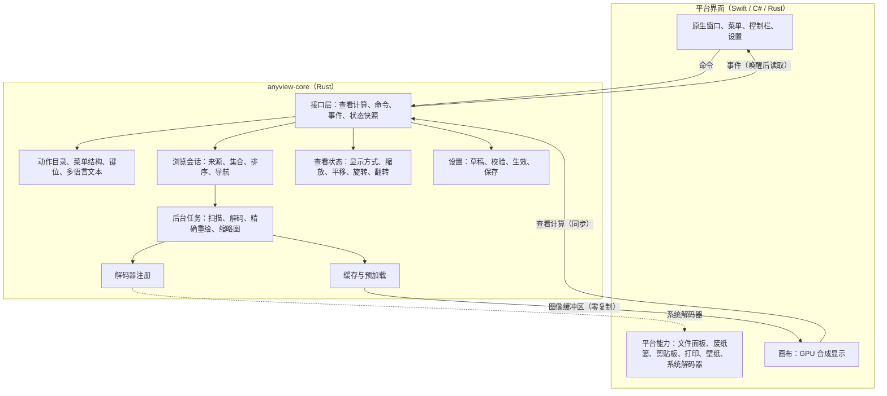

# Anyview 软件架构

本文说明 Anyview 的技术架构：共用核心模块、核心与界面接口、画布与渲染路径、解码与色彩管理、后台任务与缓存、设置系统以及目录结构。

## 技术选型

| 层 | 实现 |
| --- | --- |
| 共用核心 | Rust（edition 2024），`crates/anyview-core` |
| 跨语言绑定 | UniFFI（proc-macro）生成 Swift 与 C# 绑定（C# 使用 `third_party/uniffi-bindgen-cs`）；像素缓冲区通过少量 C 接口零复制共享 |
| macOS 界面 | Swift + AppKit（macOS 26+ 控制栏使用 SwiftUI / Liquid Glass），画布基于 Core Animation |
| Windows 界面 | C# + WinUI 3（Windows App SDK），Native AOT 发布，画布基于 Win2D / Direct2D |
| Linux 界面 | Rust + GTK 4（gtk-rs），不依赖 libadwaita，自定义 `GtkWidget` 由 GSK 绘制 |
| 解码 | 纯 Rust 解码器为主，系统解码器（macOS ImageIO / Windows WIC / Linux 系统 libheif）与随库编译的 LibRaw / jxrlib 补充 |
| 高质量重采样 | `fast_image_resize`（SIMD：Bicubic、Lanczos） |
| EXIF | 自研轻量解析（`exif.rs`），提取缩略图与关键拍摄元数据，容错跳过损坏标签 |
| 色彩管理 | macOS 交由 ColorSync；Windows 与 Linux 使用 `qcms` |
| 压缩包 | `zip`、`sevenz-rust2`、`unrar`（仅解压）；包内条目以虚拟路径表示，按需解至临时目录 |
| 设置存储 | 带版本号的 TOML 配置文件 |

## 总体结构



## 核心模块

| 模块 | 职责 |
| --- | --- |
| `api` | 对外入口 `AppCore`：命令分发、事件队列、状态快照、唤醒回调 |
| `actions` | 动作目录、菜单树数据、各平台默认键位与键鼠映射解析 |
| `i18n` | 19 种语言界面文本表与翻译查找 |
| `source` | 路径解析、目录扫描、压缩包读取（将文件与包内条目统一为条目） |
| `session` | 浏览集合、排序、当前项与导航规则（首尾策略、随机历史、跨文件夹/压缩包） |
| `view` | 显示方式、缩放档位、缩放中心、平移边界、旋转翻转、双页布局（纯计算） |
| `decode` | 解码器接口、按文件头识别格式、Rust 解码器、系统解码器适配与快速预览 |
| `render` | 精确重采样（Bilinear、Bicubic、Lanczos）、锐化、反相、Gamma 补偿 |
| `jobs` | 后台线程池、任务优先级、代次号与取消机制 |
| `cache` | 解码与预览缓存、内存上限控制与方向预加载 |
| `metadata` | 文件元数据、EXIF 字段与 AI 生成参数解析 |
| `settings` | 设置表、默认值、校验、草稿机制、TOML 读写与版本迁移 |
| `bookmarks` | 压缩包内上次浏览位置记忆 |

核心完全不依赖平台窗口与 UI 控件，可在任意平台直接通过 `cargo test` 验证。

## 核心与界面的接口

### 两类调用

1. **查看计算（同步）**：缩放、平移、视口尺寸变化等高频交互由界面同步调用核心，仅做纯数学计算（微秒级），不涉及 I/O：
   - 核心接口：`view_set_viewport`、`view_show_image`、`view_clear`、`view_layout`、`view_pan_by`、`view_zoom_by`、`view_zoom_step`、`view_toggle_fit_actual`、`view_image_to_screen`、`view_screen_to_image`。
   - 返回的 `Layout` 包含图片中心、未旋转显示宽高、倍率、旋转角度（0/90/180/270）、翻转状态和平滑标记；界面按「平移 → 屏幕方向翻转 → 旋转」设置 GPU 变换。
2. **命令（异步）**：打开文件、切图、排序、应用设置等通过 `invoke_action` / 命令分发立即返回，结果以事件异步送达。

```text
边缘箭头 ─┐
快捷键 ───┼→ invoke_action("next_image") → 核心定位目标并调度解码 → 事件 → 界面刷新
菜单项 ───┘
```

### 唤醒、线程与多窗口

- 核心仅回调单个 `wake()` 通知界面“有新事件”，界面再于主线程调用 `drain_events()` 消费：
  - macOS：`DispatchQueue.main.async`
  - Windows：`DispatcherQueue.TryEnqueue`
  - Linux：`glib::MainContext::invoke`
- 文件 I/O、目录扫描与图片解码全部在核心后台线程池运行，不阻塞界面线程。
- **多窗口共享**：同进程内每个窗口持有独立的 `AppCore`（独立浏览集合与查看状态），通过 `new_window` 共享内部 `Hub`（设置、共享像素缓存、后台线程池）；各窗口保护各自当前显示与预加载目标不被其他窗口淘汰。
- **启动并发**：启动时先创建核心并立即发起首张图片解码，同时并行初始化窗口与菜单，窗口就绪后立即派发缓存事件，缩短首帧时间。

### 事件、代次与图像缓冲区

- 每个异步任务携带代次号（generation）；切图时代次递增，核心与界面双重过滤过期结果，防止旧图覆盖新图。
- 图像缓冲区统一采用 8 位预乘 Alpha 的 BGRA（CoreGraphics、Direct2D、GDK 原生格式），由核心引用计数管理；跨语言仅传递句柄与只读像素指针，避免额外整图拷贝。

## 画布与渲染

### 双渲染路径

- **交互路径**：将当前图片上传为 GPU 纹理，缩放/平移时仅更新变换矩阵（缩小时使用 mipmap 过滤），保证高帧率跟手。
- **精确路径**：交互静止约 100 ms 且画面签名未变时，核心在后台对可见区域执行 SIMD 高质量重采样（Bicubic / Lanczos 及可选锐化），生成与屏幕物理像素一一对应的覆盖层；一旦开始下一次交互立即撤下覆盖层。
- 像素边缘模式对应关系：
  - `无`：两条路径均用最近邻。
  - `减淡` + Bilinear：仅走交互路径。
  - `减淡` + Bicubic/Lanczos，或 `减淡+锐化`：启用精确路径。

### 快速预览与超大图代理

- **快速预览**：当大图仍在解码时，核心并行读取 JPEG 文件头内嵌的 EXIF 缩略图以 `ImagePreview` 先行显示，随后清晰图以 `ImageUpdated` 无缝替换纹理而不重置缩放/平移状态。
- **超大图代理**：任一边超过 16384 像素时，核心生成长边 8192 像素的代理纹理供交互路径使用；放大超过代理比例时由精确路径按原图可见区域重绘细节。

### 效果、双页、动图与翻页过渡

- 反相与 Gamma 补偿由核心生成并按「文件 + 效果」键缓存；旋转、翻转与 EXIF 方向通过变换矩阵表达，导出剪贴板/打印/壁纸时再烘焙像素。
- 智能双页模式由核心确定配对规则并在后台合成单幅画面送给界面。
- 动图按需逐帧解码并按帧时长驱动切换；翻页过渡动画参数与合成翻纸音效均由核心统一计算，各端负责绘制与播放。

## 后台任务、缓存与预加载

- **任务优先级**：当前图预览 > 当前图完整解码 > 精确重绘 > 翻页方向下一张 > 反方向预读 > 目录扫描后续 > 选图缩略图。
- **去重与容错**：同一文件同时仅保留一条有效解码请求；快速连翻时跳过已经不再需要的中间图；后台解码/合成异常（panic）被隔离并转为可展示的错误事件。
- **预加载与缓存预算**：默认按解码后像素字节计 1 GB 上限（可在设置中调至 100–4096 MB），预读张数默认 5 张（可调 1–20 张），按 LRU 淘汰并保护当前图与预读目标。
- **后台变更检测**：由独立后台线程周期检查当前图、缓存图、目录及配置文件变更，不在界面线程读盘。

## 设置与多语言

- 所有设置项统一登记在 `crates/anyview-core/src/settings.rs` 的定义表中，驱动 UI 表单生成、草稿编辑、校验、生效与 TOML 持久化。详见 [SETTINGS.md](SETTINGS.md)。
- 界面文本表内置于核心（支持 19 种语言），菜单、提示、通知与设置页共用一套翻译键；系统原生文件面板和打印对话框自动跟随系统语言。

## 目录结构

```text
anyview/
├─ Cargo.toml                # Rust 工作区
├─ crates/
│  ├─ anyview-core/          # 平台无关核心（解码、浏览、渲染、设置、多语言）
│  ├─ anyview-ffi/           # UniFFI 与零复制 C 接口导出（供 macOS / Windows）
│  ├─ anyview-libraw/        # LibRaw C++ 封装 crate
│  ├─ anyview-jxr/           # jxrlib C 封装 crate
│  ├─ anyview-fixtures/      # 测试图片生成与解码器核对工具
│  └─ uniffi-bindgen/        # Swift 绑定生成入口
├─ apps/
│  ├─ macos/                 # Swift + AppKit 应用与 Quick Look 扩展
│  ├─ windows/               # C# + WinUI 3 应用（Anyview/ 与 binding-check/）
│  └─ linux/                 # Rust + GTK 4 应用与 Flatpak 配置
├─ tools/
│  ├─ macos/                 # macOS 编译、自检、打包与清理脚本
│  ├─ windows/               # Windows 交叉编译、打包、NSIS 安装程序与测试脚本
│  ├─ linux/                 # Linux Flatpak 与桌面容器自检脚本
│  ├─ icon/                  # 从 SVG 生成三端应用图标
│  ├─ i18n/                  # 多语言翻译校验脚本
│  ├─ licenses/              # 第三方许可证汇总生成工具
│  └─ testdata/              # 开放许可测试图片下载与校验脚本
├─ third_party/              # 随仓库收录的第三方开源库（见 THIRD_PARTY_NOTICES.md）
├─ assets/                   # 应用图标源文件
└─ docs/                     # 技术文档
```
